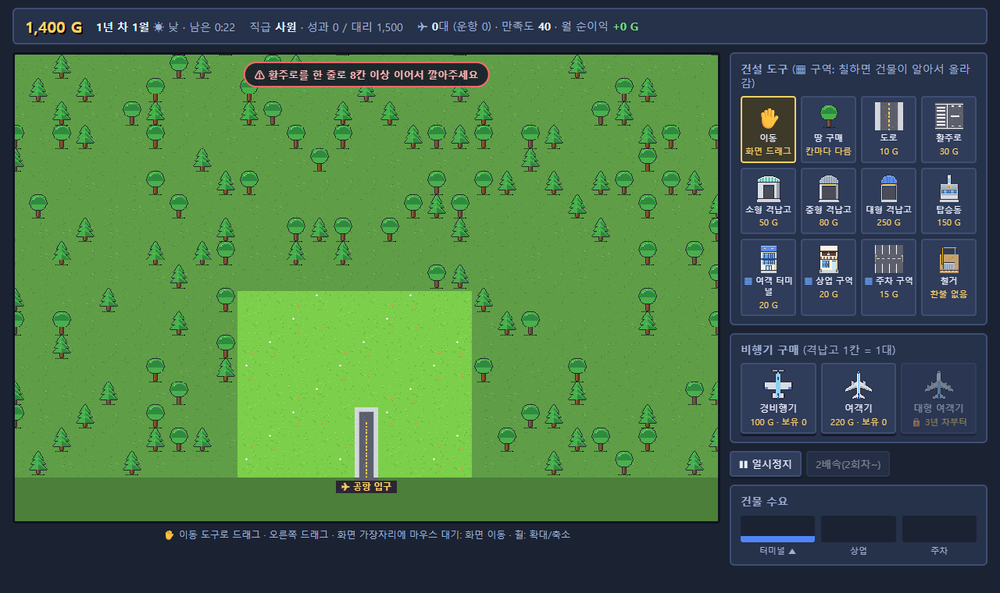
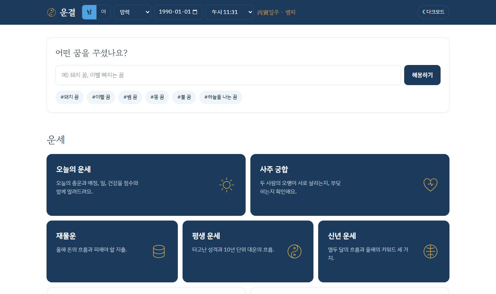

<div align="center">


</div>

```
┌─ PLAYER ─────────────────────────────
│  NAME    채웅
│  CLASS   Physical AI 교육생
│  LV      1   [■■■■■□□□□□]  EXP 50%
│  SKILL   Python · YOLO · MediaPipe · TypeScript
│  STATUS  만드는 중...
└──────────────────────────────────────
```

> **채웅** : 카메라로 손 움직임 잡아내는 거랑, 직접 해보고 싶은 게임 만들고 있어요.

<br/>

## ★ MAIN QUEST

### ✈ 신입사원 공항 키우기

<a href="https://airport-rookie.onrender.com/"></a>

빈 땅에 활주로 깔고, 격납고 짓고, 비행기 사서 공항을 키우는 도트 경영 시뮬레이션.
신입사원으로 시작해서 10년 안에 회장까지 올라가야 하는데, 게임 중간에 회사 규칙이 갑자기 바뀝니다.
그래픽은 이미지 파일 없이 전부 코드로 픽셀을 찍어서 그렸어요.

<a href="https://airport-rookie.onrender.com/"></a>
<a href="https://github.com/chaechaechae99/airport-rookie"></a>


<sub>무료 서버라 처음 열 때 1분쯤 걸릴 수 있어요</sub>

<br/><br/>

### ☯ 운결

<a href="https://chaechaechae99.github.io/fortune-service-site/"></a>

사주 · 타로 · 꿈해몽을 한 곳에서 보는 운세 사이트.
만세력 계산을 직접 짜고 정답 데이터랑 비교해 가며 맞췄어요. 입력한 생년월일은 서버에 안 남고 내 브라우저에만 저장돼요.

<a href="https://chaechaechae99.github.io/fortune-service-site/"></a>
<a href="https://github.com/chaechaechae99/unkyeol"></a>


<br/>

## ☆ SIDE QUEST

```
STAGE 1  VISION
  ├ yolo26-webcam ........ 웹캠으로 사물 찾고 따라가기
  ├ hand-landmark ........ 손가락 마디 21개 실시간 추적
  ├ gesture-recognition .. 손 모양 보고 제스처 맞히기
  └ face-landmark ........ 얼굴 점 찍어서 표정 따라가기

STAGE 2  ARCADE
  ├ snake ................ 몸짓으로 조종하는 뱀게임
  └ whack-a-mole ......... 두더지 잡기

STAGE 3  ETC
  ├ pc-dragonball ........ 150만원으로 컴퓨터 맞추기
  ├ ardushop ............. 아두이노 쇼핑몰
  └ electronics-basics ... 비전공자용 전자전기 10강
```

[yolo26-webcam](https://github.com/chaechaechae99/yolo26-webcam) ·
[hand-landmark](https://chaechaechae99.github.io/hand-landmark/) ·
[gesture-recognition](https://github.com/chaechaechae99/gesture-recognition) ·
[face-landmark](https://github.com/chaechaechae99/face-landmark) ·
[snake](https://github.com/chaechaechae99/snake) ·
[whack-a-mole](https://chaechaechae99.github.io/whack-a-mole/) ·
[pc-dragonball](https://chaechaechae99.github.io/pc-dragonball/) ·
[ardushop](https://github.com/chaechaechae99/ardushop) ·
[electronics-basics](https://github.com/chaechaechae99/electronics-basics)

<br/>

## ◆ BONUS STAGE

<picture>
  <source media="(prefers-color-scheme: dark)" srcset="https://raw.githubusercontent.com/chaechaechae99/chaechaechae99/output/github-snake-dark.svg" />
  <source media="(prefers-color-scheme: light)" srcset="https://raw.githubusercontent.com/chaechaechae99/chaechaechae99/output/github-snake.svg" />
  
</picture>

<div align="center">

```
CONTINUE?  ▶ YES    NO
```

</div>
