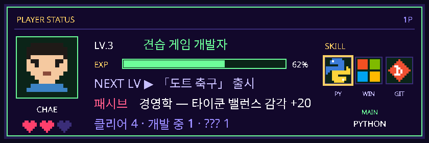

### 🕹 STAGE SELECT

| STAGE | GAME | | STATUS | |
|:-:|:--|:--|:-:|:-:|
| 1 | **신입사원 공항 키우기** | 입사 첫날, 회사가 빈 땅을 주며 말했다. "공항 하나 지어 와." | ★ CLEAR | [▶ PLAY](https://airport-rookie.onrender.com/) |
| 2 | **운결** | 어젯밤 꾼 돼지 꿈, 진짜 돈 들어오는 꿈일까? | ★ CLEAR | [▶ PLAY](https://chaechaechae99.github.io/fortune-service-site/) |
| 3 | **두더지 잡기** | 손이 빠르다고 자신하는 사람만. | ★ CLEAR | [▶ PLAY](https://chaechaechae99.github.io/whack-a-mole/) |
| 4 | **모션 스네이크** | 키보드는 치워 두세요. 몸을 흔들면 뱀이 움직입니다. | ★ CLEAR | [▶ CODE](https://github.com/chaechaechae99/snake) |
| 5 | **도트 축구** | 공 하나, 픽셀 몇 개, 그리고 90분. | ▶ 개발 중 | — |
| ? | **???** | 아직 말할 수 없음. | 🔒 LOCKED | — |

<b>BONUS ROOM</b> — 비전 AI 실험들

[yolo26-webcam](https://github.com/chaechaechae99/yolo26-webcam) · [hand-landmark](https://chaechaechae99.github.io/hand-landmark/) · [gesture-recognition](https://github.com/chaechaechae99/gesture-recognition) · [face-landmark](https://github.com/chaechaechae99/face-landmark) · [pc-dragonball](https://chaechaechae99.github.io/pc-dragonball/) · [ardushop](https://github.com/chaechaechae99/ardushop)

<picture><source media="(prefers-color-scheme: dark)" srcset="https://raw.githubusercontent.com/chaechaechae99/chaechaechae99/output/github-snake-dark.svg" /><source media="(prefers-color-scheme: light)" srcset="https://raw.githubusercontent.com/chaechaechae99/chaechaechae99/output/github-snake.svg" /></picture>
