### 🕹 STAGE SELECT

| STAGE | GAME | GENRE | STATUS | |
|:-:|:--|:--|:-:|:-:|
| 1 | **신입사원 공항 키우기** | 공항 경영 시뮬레이션 | ★ CLEAR | [▶ PLAY](https://airport-rookie.onrender.com/) |
| 2 | **운결** | 사주 · 타로 · 꿈해몽 | ★ CLEAR | [▶ PLAY](https://chaechaechae99.github.io/fortune-service-site/) |
| 3 | **두더지 잡기** | 아케이드 | ★ CLEAR | [▶ PLAY](https://chaechaechae99.github.io/whack-a-mole/) |
| 4 | **모션 스네이크** | 몸짓으로 조종 | ★ CLEAR | [▶ CODE](https://github.com/chaechaechae99/snake) |
| 5 | **도트 축구 매니저** (가제) | 구단 운영 + 경기 시뮬 | ▶ 개발 중 | — |
| ? | **???** | 타이쿤 | 🔒 LOCKED | — |

<b>BONUS ROOM</b> — 비전 AI 실험들

[yolo26-webcam](https://github.com/chaechaechae99/yolo26-webcam) · [hand-landmark](https://chaechaechae99.github.io/hand-landmark/) · [gesture-recognition](https://github.com/chaechaechae99/gesture-recognition) · [face-landmark](https://github.com/chaechaechae99/face-landmark) · [pc-dragonball](https://chaechaechae99.github.io/pc-dragonball/) · [ardushop](https://github.com/chaechaechae99/ardushop)

<picture><source media="(prefers-color-scheme: dark)" srcset="https://raw.githubusercontent.com/chaechaechae99/chaechaechae99/output/github-snake-dark.svg" /><source media="(prefers-color-scheme: light)" srcset="https://raw.githubusercontent.com/chaechaechae99/chaechaechae99/output/github-snake.svg" /></picture>
