### ▶ NOW PLAYING

| GAME | | |
|:--|:--|:-:|
| **신입사원 공항 키우기** | 빈 땅에서 시작해 공항 재벌까지 | [1P START](https://airport-rookie.onrender.com/) |
| **운결** | 오늘 운세 뽑기 | [1P START](https://chaechaechae99.github.io/fortune-service-site/) |
| **두더지 잡기** | 손이 빠른 사람만 | [1P START](https://chaechaechae99.github.io/whack-a-mole/) |
| **모션 스네이크** | 키보드 대신 몸으로 | [SOURCE](https://github.com/chaechaechae99/snake) |

### 🏆 HIGH SCORE — 써 본 언어 & 도구


| RANK | NAME | PLAYED IN |
|:-:|:--|:--|
| 1ST | **Python** | 공항 키우기 (tkinter · 웹 서버), YOLO · MediaPipe 비전 실험 |
| 2ND | **TypeScript** · Next.js | 운결, ardushop |
| 3RD | **JavaScript** · HTML · CSS | 두더지 잡기, 모션 스네이크, PC 견적 페이지 |
| 4TH | **Git** · GitHub | 지금 보고 있는 이 프로필 |

### COMING SOON

```
??? 축구 게임 ............ 제작 대기
??? 타이쿤 ............... 기획 중
```

<details><summary>연구실 — 비전 AI 실험들</summary>

[yolo26-webcam](https://github.com/chaechaechae99/yolo26-webcam) · [hand-landmark](https://chaechaechae99.github.io/hand-landmark/) · [gesture-recognition](https://github.com/chaechaechae99/gesture-recognition) · [face-landmark](https://github.com/chaechaechae99/face-landmark) · [pc-dragonball](https://chaechaechae99.github.io/pc-dragonball/) · [ardushop](https://github.com/chaechaechae99/ardushop)

</details>

<picture><source media="(prefers-color-scheme: dark)" srcset="https://raw.githubusercontent.com/chaechaechae99/chaechaechae99/output/github-snake-dark.svg" /><source media="(prefers-color-scheme: light)" srcset="https://raw.githubusercontent.com/chaechaechae99/chaechaechae99/output/github-snake.svg" /></picture>
